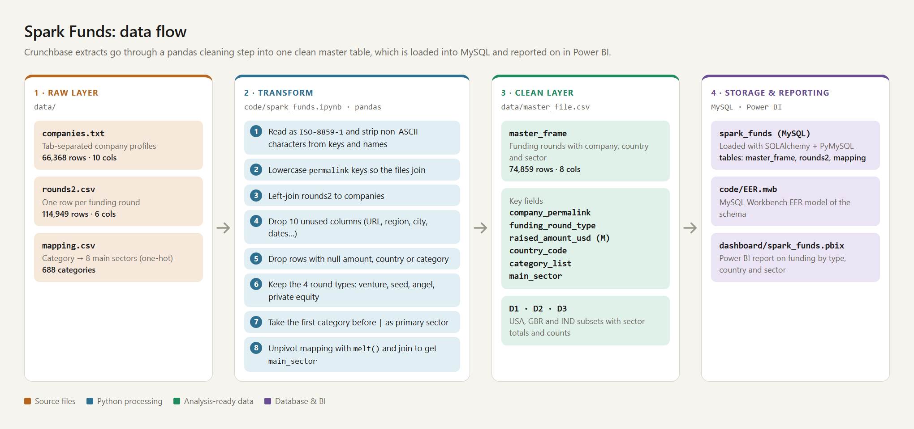

# Spark Funds Investment Analysis

## Architecture



An interactive version of the diagram is in [asset/data_flow.html](asset/data_flow.html).

## Business Overview

Spark Funds is an asset management company that wants to invest in a small number of companies. Its CEO needs to understand global investment trends to make these decisions well. ([Reference fund profile](https://pitchbook.com/profiles/fund/19597-15F#overview))

The fund has three constraints:

- It invests **5 to 15 million USD per round**.
- It invests only in **English-speaking countries**, so communication with portfolio companies is easy.
- For each investment it picks **one of four funding types**: Seed, Angel, Venture or Private Equity.

Its strategy is to **invest where most other investors are investing**, a pattern common among early-stage startup investors. The analysis identifies the best funding type, countries and sectors that fit this strategy.

## Aim

Build a Python pipeline that cleans and joins raw Crunchbase funding data into one analysis-ready table, analyses it by funding type, country and sector, loads the results into a MySQL database and reports on them in a Power BI dashboard.

## Dataset Description

Source: real investment data from [Crunchbase](https://www.crunchbase.com/). The files go in `data/`. This folder is git-ignored, so you need to add the files yourself.

| File | Rows | Description |
|---|---|---|
| `companies.txt` | 66,368 | Basic company details (tab-separated) |
| `rounds2.csv` | 114,949 | Funding details for each round a company raised |
| `mapping.csv` | 688 | Maps detailed category names (3D printing, aerospace, agriculture…) to eight broad sectors, so the analysis uses 8 sectors instead of hundreds of categories |
| `master_file.csv` | 74,859 | **Clean layer** produced by the notebook |

Key fields in the clean `master_file.csv`:

- `company_permalink`: unique company key
- `funding_round_type`: venture, seed, angel or private_equity
- `raised_amount_usd` / `raised_amount_usd (M)`: round size in USD and in millions of USD
- `country_code`: ISO 3-letter country code
- `category_list`: primary category (first value before `|`)
- `main_sector`: one of the eight broad sectors from `mapping.csv`


## Tech Stack

**Language:** Python (Jupyter Notebook), SQL

**Libraries:** pandas, NumPy, SQLAlchemy, PyMySQL

**Services/Tools:** MySQL, MySQL Workbench, Power BI Desktop

## Setup / How to Run

Install the Python dependencies:

```bash
pip install pandas numpy sqlalchemy pymysql jupyter
```

Put the raw Crunchbase files in `data/`. The notebook reads files by name only, so start Jupyter from that folder:

```bash
cd data
jupyter notebook ../code/spark_funds.ipynb
```

Before running the "Loading data into DB" section, start a local MySQL server and change the connection settings in the notebook to your own user and password.

Open `dashboard/spark_funds.pbix` in Power BI Desktop to see the report.
